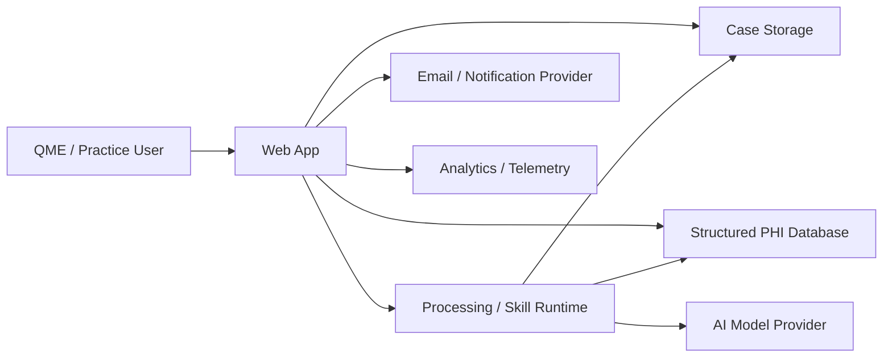

# Current-State Data Flow

Use this template after the interview. Replace placeholders with actual systems and evidence labels. The diagram below illustrates possible components, not an assumed architecture. Delete unused nodes and edges. Label each retained path VERIFIED, REPORTED, or UNKNOWN and cite its evidence ID. Retain the granularity actually supplied: a notification renderer does not establish a worker architecture, and a finalization requirement does not establish a completed finalization path. A physician using one service may need only a device, service, and export path. Record the audit host and report storage as a separate path.

## Trust boundaries

Document at least:

- customer device ↔ application
- production ↔ non-production
- operator ↔ subprocessors
- case/tenant ↔ other case/tenant
- PHI boundary ↔ PHI-blind external services

## Data inventory

Components and subprocessors are different inventories. List a component as an external vendor only when evidence establishes that relationship; otherwise keep its vendor/owner UNKNOWN.

| Component | Vendor / owner | Data handled | PHI? | Region | Contract/BAA status | Evidence level |
|---|---|---|---|---|---|---|
| Web app |  |  |  |  |  |  |
| Source storage |  |  |  |  |  |  |
| Database |  |  |  |  |  |  |
| Model runtime |  |  |  |  |  |  |
| Email |  |  |  |  |  |  |
| Analytics |  |  |  |  |  |  |

## Notes

- Distinguish persistent storage from transient processing.
- Include derived PHI, not only original PDFs.
- Include URLs, logs, analytics, and email when identifiers can leak there.
- If a system is unverified, label it UNKNOWN rather than assuming the intended architecture is real.
